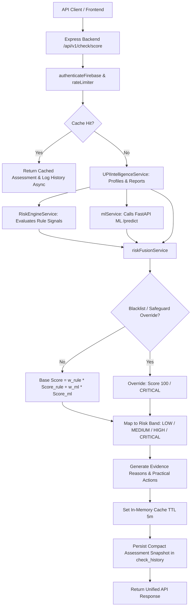

# Intelligent Risk Fusion Engine (Phase 9)

## 1. Overview & Architecture

The **SafeSignal Intelligent Risk Fusion Engine** (`riskFusionService.js`) unifies multiple layers of risk signals into a single, explainable, and auditable risk assessment for any UPI identifier.

Before Phase 9, SafeSignal maintained separate scoring tracks:
- **Phase 4:** Deterministic rule-based heuristic scoring (`RiskEngineService.js`).
- **Phase 5 & 6:** Community report moderation and internal blacklists.
- **Phase 8:** Machine Learning inference predicting fraud probabilities (`mlService.js` calling the FastAPI Random Forest microservice).

Phase 9 integrates these independent signal streams into a centralized decision engine with deterministic safeguards, shadow-mode deployment, duplicate suppression, and backward-compatible API contracts.

### Architecture & Data Flow



---

## 2. Risk Score Contract & Bands

All risk scores are normalized to an integer scale of **0–100**:
- **0**: Indicates lowest observed risk across available SafeSignal data.
- **100**: Indicates maximum observed risk (e.g., active internal blacklist).

> **Important Disclaimer:** Risk scores represent internal estimates of potential risk based on available SafeSignal intelligence. They are not absolute guarantees of fraud or proof of safety. SafeSignal never describes a LOW risk score as guaranteed safe.

### Configured Default Bands

| Level | Score Range | Default Meaning & System Guidance |
|---|---|---|
| **`LOW`** | `0 – 24` | Minimal observed risk; caution advised before authorizing payment. |
| **`MEDIUM`** | `25 – 49` | Elevated risk indicators present; independent verification recommended. |
| **`HIGH`** | `50 – 74` | Significant risk indicators or verified reports; pause transaction. |
| **`CRITICAL`** | `75 – 100` | Severe risk or active blacklist entry; avoid proceeding. |

---

## 3. Score Fusion Formula & Default Weights

When the Machine Learning model is **eligible for fusion**, the base score is calculated as:

$$\text{base\_score} = \left(w_{\text{rule}} \times \text{rule\_score}\right) + \left(w_{\text{ml}} \times (\text{fraud\_probability} \times 100)\right)$$

Where:
- $\text{rule\_score} \in [0, 100]$ is the deterministic heuristic score from `RiskEngineService`.
- $\text{fraud\_probability} \in [0.0, 1.0]$ is the probability estimated by the ML model.
- $w_{\text{rule}} + w_{\text{ml}} = 1.0$.

### Initial Engineering Default Weights

- **$w_{\text{rule}}$ (Rule Weight):** `0.70`
- **$w_{\text{ml}}$ (ML Weight):** `0.30`

> **Note on Weights:** These initial weights are **engineering defaults**, not scientifically or empirically validated optimal weights. As real-world transaction and reporting data accumulates, these weights can be recalibrated via SafeSignal's administrative configuration without requiring code deployments.

When ML is unavailable, timed out, or ineligible (such as during SHADOW mode), the base score defaults directly to the deterministic rule score without artificial renormalization:

$$\text{base\_score} = \text{rule\_score}$$

---

## 4. Machine Learning Eligibility Policy

To protect scoring integrity, an ML prediction may contribute to the final user-facing score **only if all of the following conditions are met**:

1. **Successful Request:** `mlResult.available === true`.
2. **Valid Probability:** `fraud_probability` is a finite number in the range $[0.0, 1.0]$.
3. **Present Model Version:** `model_version` is a non-empty string (e.g., `'rf-v1.0.0'`).
4. **Compatible Feature Schema:** `feature_schema_version` is supported (current supported version: `'1.0'`).
5. **Active Model Status:** The model status in metadata is validated as `ACTIVE`.
6. **Synthetic Model Policy Check:** Models bootstrapped exclusively on synthetic training data adhere strictly to `ML_SYNTHETIC_MODEL_POLICY`.

### Synthetic Model Policy (`ML_SYNTHETIC_MODEL_POLICY`)

Configured via environment variable or administrative settings:
- **`SHADOW` (Default):** The ML prediction is fetched and returned in the API response under `signals.ml` for internal telemetry, analysis, and validation, but **does not affect the final score**.
- **`DISABLED`:** ML is bypassed or ignored completely.
- **`ENABLED`:** ML contributes to the final score using the configured weighted formula.

> **Caution:** Synthetic benchmark metrics (such as 100% accuracy on synthetic distributions) do not establish real-world accuracy. `SHADOW` mode remains the safe default until independently held-out real-world validation data is available.

---

## 5. Deterministic Overrides & Safeguards

### 1. Active Internal Blacklist Override
If a UPI identifier matches an active entry in the SafeSignal internal blacklist:
- **Final Risk Score:** `100` (Max)
- **Risk Level:** `CRITICAL`
- **Reason Code:** `BLACKLISTED_IDENTIFIER`
- **Recommended Action:** `"Avoid proceeding with the payment. Verify the recipient through your payment provider."`

### 2. Conflicting Signals Safeguard
If a model trained on synthetic data predicts a low fraud probability (e.g., $0.05$), but deterministic rules have flagged `HIGH` risk ($\ge 50$) or `CRITICAL` risk based on approved community reports or velocity spikes:
$$\text{final\_score} = \max(\text{base\_score}, \text{rule\_score})$$
A low synthetic ML prediction is never permitted to suppress or lower a high-risk flag identified by human moderators or deterministic rules.

---

## 6. Community Signal Handling & Double-Counting Prevention

Community signals are segregated strictly by moderation outcome:
- **`APPROVED`**: Confirmed citizen reports reviewed and approved by moderators.
- **`PENDING`**: Unverified reports under review; contributing minor heuristic context but not treated as verified fraud.
- **`REJECTED`**: Suppressed reports; discarded from positive fraud evidence.

### Duplicate Reporter Suppression
Multiple reports submitted by the same `reporterUid` against the same identifier are deduplicated to establish `unique_reporter_count`. This prevents coordinated denial or spam attempts from inflating fraud severity.

### No Double-Counting Guarantee
Because `RiskEngineService` already incorporates verified report volume, pending counts, and velocity into `rule_score`, `community_score` is computed purely for explainability and telemetry in `signals.community`. It is **not** added additively on top of `rule_score` in the fusion formula, completely preventing double-counting.

---

## 7. Evidence-Based Reason Codes

Every reason returned by SafeSignal corresponds directly to observed database facts or model outputs:

| Reason Code | Source | Severity | Description |
|---|---|---|---|
| `BLACKLISTED_IDENTIFIER` | `INTERNAL_BLACKLIST` | `CRITICAL` | Identifier is explicitly flagged in SafeSignal blacklist. |
| `APPROVED_REPORTS_PRESENT` | `COMMUNITY` | `MEDIUM` / `HIGH` | One or more citizen reports have been verified by moderators. |
| `MULTIPLE_INDEPENDENT_REPORTERS` | `COMMUNITY` | `HIGH` | Verified reports originated from $\ge 2$ distinct citizen accounts. |
| `RECENT_FRAUD_REPORTS` | `COMMUNITY` | `HIGH` | Approved reports were logged within the last 7 days. |
| `SCAM_CATEGORY_FLAGGED` | `COMMUNITY` | `HIGH` | Specific fraud categories (e.g. investment, phishing) identified. |
| `RULE_RISK_INDICATORS` | `RULES` | `MEDIUM` / `HIGH` | Rule engine detected velocity spikes or anomaly patterns. |
| `ML_SHADOW_EVALUATION` | `ML` | `LOW` | Model evaluated in shadow mode without altering score. |
| `ML_FRAUD_PROBABILITY_ELEVATED` | `ML` | `HIGH` | Active ML model predicted elevated fraud probability ($\ge 0.5$). |
| `ML_FRAUD_PROBABILITY_LOW` | `ML` | `LOW` | Active ML model predicted low fraud probability ($< 0.2$). |
| `ML_SIGNAL_UNAVAILABLE` | `SYSTEM` | `LOW` | ML microservice was offline or timed out; fallback applied. |
| `NO_KNOWN_REPORTS` | `SYSTEM` | `LOW` | Identifier has no flags or negative records in SafeSignal. |

---

## 8. Confidence Labels

SafeSignal provides honest confidence labels reflecting data completeness:
- **`INSUFFICIENT_DATA`**: The identifier is completely new/unknown with no reports or profile.
- **`LIMITED_DATA`**: Less than 2 approved reports and no active ML fusion.
- **`ML_SHADOW`**: Rule evaluation completed with ML running concurrently in shadow mode.
- **`RULES_ONLY`**: ML was disabled, ineligible, or unavailable; evaluation based strictly on rules.
- **`MULTIPLE_SIGNALS`**: Both deterministic rules and active ML predictions contributed to the fused score.

---

## 9. API Response Contract

Endpoint: `POST /api/v1/check/score`

The response includes new Phase 9 unified fields while preserving all legacy fields:

```json
{
  "success": true,
  "data": {
    "upiId": "merchant@oksbi",
    
    "risk": {
      "score": 45,
      "level": "MEDIUM",
      "reasons": [
        {
          "code": "APPROVED_REPORTS_PRESENT",
          "message": "1 approved fraud report is associated with this identifier.",
          "severity": "MEDIUM",
          "source": "COMMUNITY",
          "title": "Approved reports",
          "description": "1 citizen reports have been verified by moderators."
        },
        {
          "code": "ML_SHADOW_EVALUATION",
          "message": "The ML signal is available for internal evaluation but is not enabled in the final score.",
          "severity": "LOW",
          "source": "ML",
          "title": "ML Shadow Evaluation",
          "description": "Machine Learning estimated fraud probability (85.0%) in shadow mode."
        }
      ],
      "recommended_actions": [
        "Pause and independently verify the recipient.",
        "Review the displayed risk reasons before proceeding."
      ]
    },

    "signals": {
      "rule_score": 45,
      "ml": {
        "available": true,
        "eligible_for_fusion": false,
        "mode": "SHADOW",
        "fraud_probability": 0.85,
        "model_version": "rf-v1.0.0"
      },
      "community": {
        "available": true,
        "approved_report_count": 1,
        "unique_reporter_count": 1,
        "recent_report_count": 1,
        "signal_freshness": "LAST_24_HOURS",
        "community_score": 25
      },
      "blacklist": {
        "matched": false
      },
      "rule_signals": [...]
    },

    "assessment": {
      "engine_version": "fusion-v1.0.0",
      "config_version": "1.0.0",
      "scored_at": "2026-10-20T12:00:00.000Z",
      "confidence_label": "ML_SHADOW"
    },

    "riskScore": 45,
    "riskLevel": "MEDIUM",
    "confidenceLevel": "MEDIUM",
    "summary": "Some risk signals were found. Proceed with caution.",
    "reasons": [...],
    "fraudCategories": ["phishing"],
    "lastReportedAt": "2026-10-20T11:45:00.000Z",
    "checkedAt": "2026-10-20T12:00:00.000Z",
    "ml": { ... }
  },
  "message": "Risk assessment completed successfully."
}
```

---

## 10. Cache Management & Invalidation

- **TTL:** 5 minutes (`CACHE_TTL_MS = 300,000`).
- **Invalidation Triggers:**
  - When an admin blacklists an identifier (`AdminUPIService.blacklistUPI`).
  - When an admin removes an identifier from the blacklist (`AdminUPIService.unblacklistUPI`).
  - When a moderator approves a report (`ModerationService.approveReport`).
  - When a moderator rejects a report (`ModerationService.rejectReport`).
  - When system weights or thresholds are modified by an admin (`AdminConfigService.updateRiskConfig` calls `riskService.clearAllCache()`).

---

## 11. Check History & Auditability

Check history records stored in Firestore's `check_history` collection are enriched with a compact `assessment` snapshot:

```javascript
assessment: {
  finalScore: 45,
  riskLevel: 'MEDIUM',
  ruleScore: 45,
  mlAvailable: true,
  mlEligible: false,
  mlModelVersion: 'rf-v1.0.0',
  fusionEngineVersion: 'fusion-v1.0.0',
  configVersion: '1.0.0',
  reasonCodes: ['APPROVED_REPORTS_PRESENT', 'ML_SHADOW_EVALUATION'],
  timestamp: new Date()
}
```

**Privacy Guarantee:** Raw ML feature vectors, citizen PII, and credentials are never stored in history snapshots.

---

## 12. Safe Configuration Management

To change the synthetic model policy:
1. In development / testing: update `ML_SYNTHETIC_MODEL_POLICY=ENABLED` in `backend/.env`.
2. In production: update via the secure Administrative Configuration API (`PUT /api/v1/admin/config/risk`).
3. If an invalid or non-summing configuration is received, the engine logs an alert and automatically falls back to safe default weights (`0.70` rule, `0.30` ML) and default bands (`0-24, 25-49, 50-74, 75-100`).
